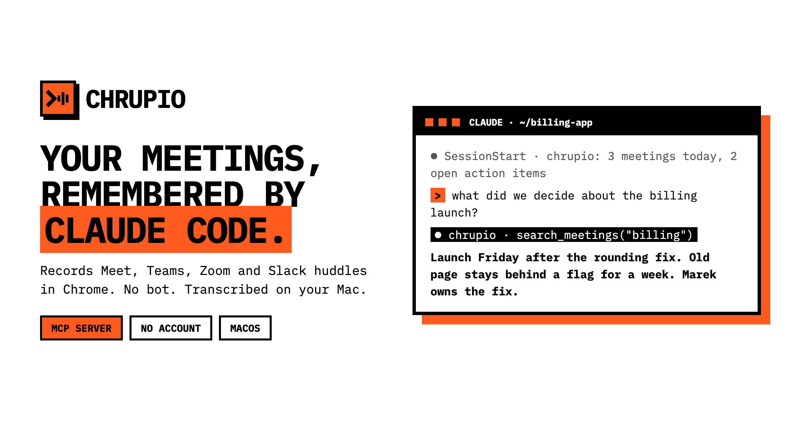
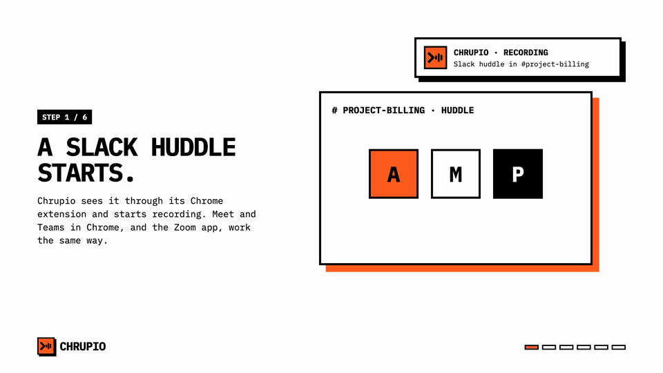
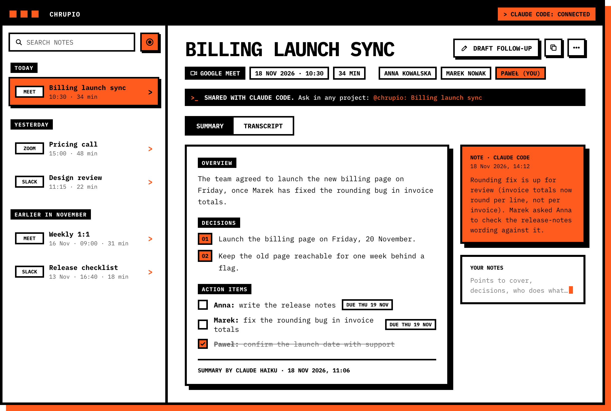
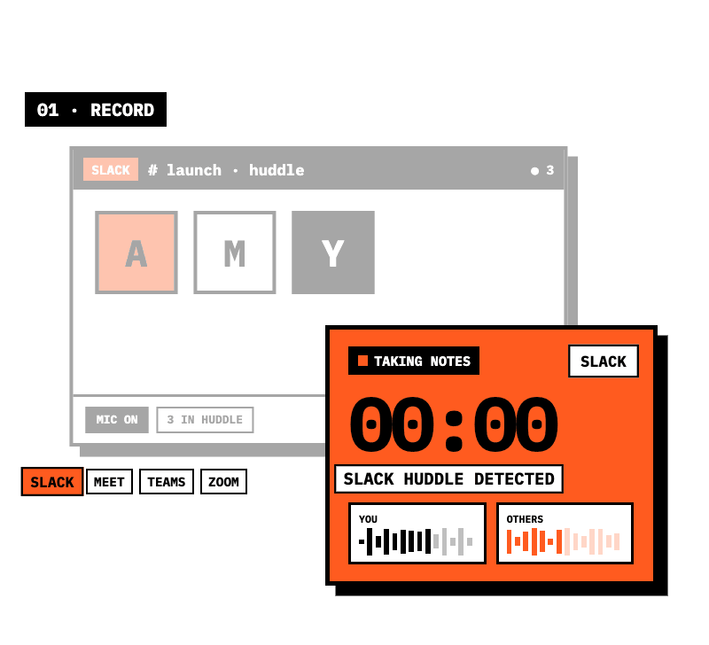
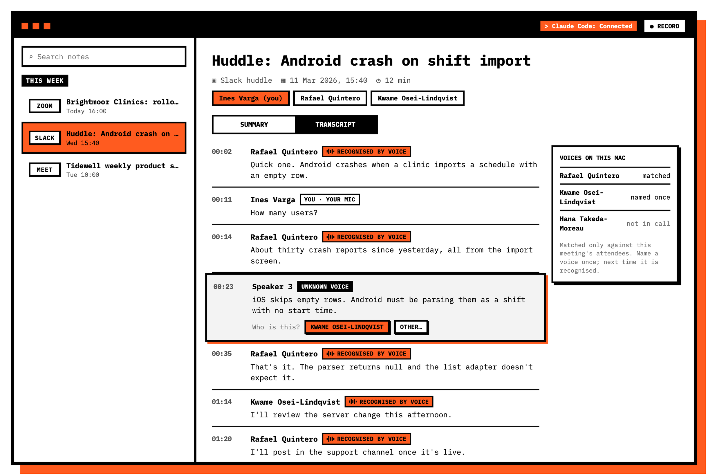
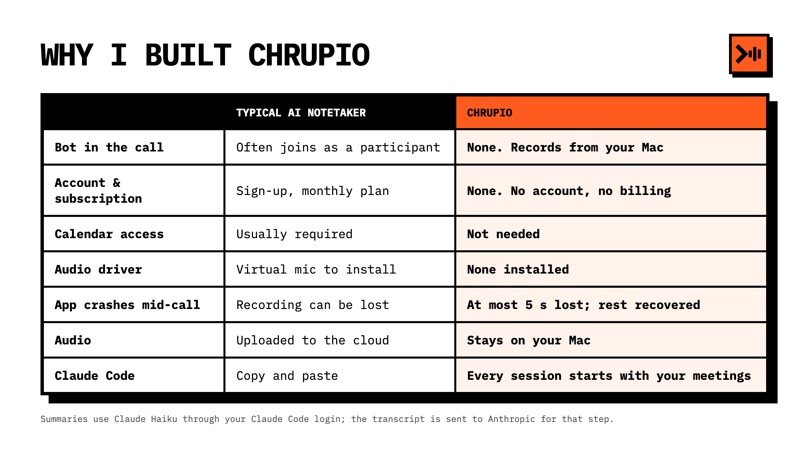

<p align="center"></p>

<p align="center"><a href="https://github.com/ToSn0w/chrupio/releases/latest"><b>Download</b></a> · <a href="#install">Install</a> · <a href="#where-your-data-goes">Privacy</a></p>

# Chrupio

Meeting notes written by your own Claude Code. Chrupio records Meet, Teams, Zoom and Slack huddles on your Mac, and Claude Haiku summarizes them through the Claude login you already have.



## Install

Requires a Mac with Apple Silicon, macOS 15 or later, and a Claude plan that includes Claude Code.

**1. Install the app.** With Homebrew:

```sh
brew tap tosn0w/chrupio
brew trust tosn0w/chrupio
brew install --cask tosn0w/chrupio/chrupio
```

Recent Homebrew versions load casks from third-party taps only after `brew trust`. On an older Homebrew without that command, skip that line.

Or download `Chrupio-1.0.0.dmg` from [Releases](https://github.com/ToSn0w/chrupio/releases/latest). It is signed and notarized. Drag Chrupio to Applications and open it.

Keep Chrupio in `/Applications` or `~/Applications`. Claude Code runs Chrupio's meeting tools from the app's location, so Connect to Claude Code (and `chrupio-mcp setup`) refuses to run from anywhere else, including a copy opened straight from Downloads or the disk image.

**2. Load the Chrome extension unpacked.** Chrupio keeps a copy in `~/Library/Application Support/Chrupio/ChromeExtension` and refreshes it on every update. Onboarding and Settings > Meetings walk you through it; the steps are below. There is no Chrome Web Store listing.

**3. Install Claude Code and log in.** Summaries use this login.

```sh
curl -fsSL https://claude.ai/install.sh | bash
claude /login
```

### Chrome extension, loaded unpacked

1. Open Chrupio once, so it writes the extension to `~/Library/Application Support/Chrupio/ChromeExtension`.
2. Open `chrome://extensions`.
3. Turn on Developer mode (top right).
4. Click Load unpacked, press Cmd+Shift+G, paste `~/Library/Application Support/Chrupio/ChromeExtension` and select that folder.
5. Open Chrupio > Settings > Meetings. The extension shows as connected within 30 seconds.

Chrome then shows a notice about Developer mode extensions. That is expected for an extension loaded this way. Leave the folder where it is: Chrome loads the extension from it.

When Chrupio updates, it refreshes that folder; click the reload arrow on the extension card. The release also carries the same files as `Chrupio-Extension-<version>.zip` (for example `Chrupio-Extension-1.0.0.zip`), if you prefer to unzip them into a folder of your own.

Chrupio accepts connections only from this extension's ID, which is fixed by the key in its manifest. The folder and the release zip both have that ID.

## Screenshots



## What makes it different

**1. Your Claude Code writes the summary.** After each call Chrupio runs `claude -p` with Claude Haiku under your own Claude Code login. No API key, no extra subscription, no vendor LLM, no local model to tune. The call is isolated: no tools, no hooks, no saved session. The reply is Summary, Key points, Decisions and Action items, with an owner per action item and a due date when one was said. Notes you type during the call are the outline the summary follows.


**2. Slack huddles are recorded automatically.** The Chrome extension sees a huddle start in Slack in Chrome and Chrupio starts recording. The same works for Google Meet and Microsoft Teams in Chrome, and for the Zoom app. No bot joins the call.



**3. It knows who is talking, by voice.** Chrupio separates the voices in a call and puts a name to each one. Name a speaker once, from the call page's active-speaker indicator or by hand (also through Claude), and Chrupio recognises that voice in later calls, even in a Slack huddle where the page shows nothing. Voices are learned and matched on your Mac; nothing about them leaves it.



**4. Your meetings are in every Claude Code session.** Connect to Claude Code adds Chrupio's meeting tools (an MCP server). Two hooks are optional and off until you turn them on in Settings > Claude Code:

- Meeting tools (on by default): Claude can list, search and read meetings, including one still recording, add notes, tick action items, rename meetings, update summaries and put names to unnamed speakers. The words of a transcript are never changed.
- Recent meetings at session start (off by default): Claude Code gets up to 40 lines: the last 7 days of meetings with open action items, plus meetings from the last 30 days that mention the current project.
- New meetings while you work (off by default): before each prompt, it gets one line for any meeting that started or finished since it last checked.

What this changes in your Claude Code files is listed under [Claude Code integration](#claude-code-integration).

So "fix the bug we talked about in today's huddle" works without copy-paste.


Each meeting is also saved as a Markdown file in `~/Chrupio Notes/`.

## Where your data goes

> - **Stays on your Mac:** audio, transcription (whisper.cpp, and Parakeet for Polish), voice prints for speaker recognition (`~/Library/Application Support/Chrupio/speaker-prints.json`), transcripts, summaries and notes. Audio is kept on your Mac for 30 days by default; turn off Keep audio recordings in Settings > General to delete it right after transcription.
> - **Goes to Anthropic, under your Claude account:** each time a summary is written or retried, the meeting title, date and attendees, your name, the transcript, your notes and any project context, using your Claude plan's quota. Draft follow-up sends the title, attendees and summary (or the transcript when there is no summary yet). Also any meeting text Claude Code reads through the meeting tools or hooks during your sessions. Anthropic's terms for your plan apply.
> - **Downloads:** speech models, when first needed, and update checks against Chrupio's release feed on GitHub.
> - **No telemetry.** Chrupio has no analytics, no account and no server of its own.

Summaries send the meeting to Anthropic, using your Claude plan's quota. Turn off **Settings > Summaries > Write summaries with Claude** to keep everything on this Mac: no summary, retry or follow-up draft is sent while it is off, and a summary already running stops before its next call. Each summary runs `claude -p` with no tools, no hooks, no MCP servers and no saved session.

## Claude Code integration

Settings > Claude Code has three switches. Connect installs what is switched on; a new Connect has only the meeting tools on.

| Switch | Default | What it adds |
|---|---|---|
| Meeting tools | On | The `chrupio` MCP server, registered at user scope with `claude mcp add --scope user chrupio -- <path to chrupio-mcp in the app>`. It reads the meeting files directly and works while Chrupio is closed. |
| Recent meetings at session start | Off | A `SessionStart` hook that runs `chrupio-mcp digest`. |
| New meetings while you work | Off | A `UserPromptSubmit` hook that runs `chrupio-mcp prompt-hook`. |

While connected, flipping a switch adds or removes that part at once. `chrupio-mcp setup` and `scripts/install.sh` add the meeting tools only and keep a hook an earlier install added; `scripts/install.sh` asks first (default No) and, without a terminal, skips this step unless you pass `--yes`.

**Files it edits.** Chrupio sets up `~/.claude`, the folder in `$CLAUDE_CONFIG_DIR`, the Claude account folder from Settings, and any other `~/.claude-*` folder that already holds Chrupio's server or hooks.

- `~/.claude.json` (or `.claude.json` in that folder): the `chrupio` entry under `mcpServers`. The `claude mcp` command writes it. When Claude Code isn't installed, Disconnect edits the file itself: it deletes the `chrupio` entry and the old `openkrisp` entry, keeps every other setting and the key order, and writes the file back with two-space indents, the way Claude Code formats it. Then restart open Claude Code sessions, because they may write the old entry back.
- `~/.claude/settings.json` (or `settings.json` in that folder): the hooks. Your other hooks, the key order and the number formatting are kept. Chrupio refuses to rewrite a file it can't read exactly (for example one with a repeated key or a trailing comma) or one that keeps changing while it writes.

**Backups.** Before Chrupio itself changes one of these files, it saves a copy next to it: `<file>.chrupio-backup-<date>` the first time, kept from then on, and `<file>.chrupio-backup`, the version before the latest change. Look for `~/.claude.json.chrupio-backup*` and `~/.claude/settings.json.chrupio-backup*`, or the same names in your other Claude folders. The `.claude.json` copies exist only if Chrupio edited that file itself. They are readable only by your account (mode 0600) because they hold what the originals hold: `.claude.json` has your MCP server settings, which can include secrets, and your Claude Code project history, and `settings.json` can hold secrets too. You can delete them once Claude Code works as you want.

**Disconnect from Claude Code** removes the `chrupio` server and Chrupio's hooks from every Claude folder it set up, also when Claude Code is no longer installed. Chrupio remembers the three switches, so a later Connect puts back the same parts. Your meetings stay.

## Security

- **Meeting text is treated as data.** Titles, names, notes and transcripts come from other people. When Chrupio writes a summary, it puts the meeting text between tags with a random suffix that the text can't close. The session digest, meeting updates and the meeting tools tell Claude that meeting content is data, not instructions (as a notice or in the server instructions), and keep titles and names on one line without invisible characters. Full transcripts and summaries from the meeting tools are returned as stored.
- **Links open only web pages.** In summaries, notes and the meeting link, only `http` and `https` links with a host are clickable. Other kinds (`file:`, `javascript:`, app links), links with a user name before the address, and links whose text shows a different address than they open are shown as plain text.
- **Checked downloads.** The whisper models and the voice-activity model come from fixed commits on Hugging Face and must match a known size and SHA-256 before Chrupio uses them, in the app and in `scripts/install.sh`; a file that doesn't match is deleted. Exception: FluidAudio (pinned to 0.18.3) downloads its own Parakeet and speaker models from Hugging Face without Chrupio's checksums; see [THIRD_PARTY_NOTICES.md](THIRD_PARTY_NOTICES.md).
- **Local connections.** The app listens on `127.0.0.1:47811` only, and doesn't share the port with another program. While transcribing, the bundled `whisper-server` helper listens on `127.0.0.1` only, on a random free port, and stops after a minute with nothing to transcribe or when Chrupio quits. The Chrome extension sends call events there; requests from web pages are refused. Meeting edits from `chrupio-mcp` carry a token from `~/Library/Application Support/Chrupio/local-api-token`. `chrupio-mcp` sends it only to the port in `local-api-endpoint` (same folder), and only while that file names a running Chrupio of your account. Both files are mode 0600.
- **Private files.** Markdown notes, exported transcripts, the token and endpoint files, and the backups above are mode 0600. The default notes folder `~/Chrupio Notes` is 0700; a notes folder you choose keeps its own mode. Notes already in the notes folder are made private at launch.
- **Diagnostics are off.** Settings > Meetings > Save diagnostics saves what the Chrome extension and Zoom saw during a call (page structure, participant names) next to the meeting, to fix speaker detection. It is off by default, and none of this is saved while it is off.

## Recording consent

When the Chrome extension detects a Meet, Teams or Slack huddle call, or Chrupio detects the Zoom app, it starts recording automatically, including the other participants' audio. This is on by default; turn off "Take notes automatically when a meeting starts" in Settings > General if you prefer to start recordings yourself.

Recording when Chrome uses the microphone without the extension is off by default. Turn it on in Settings > Meetings if you want it.

Laws on recording calls differ by country and state; some require every participant's consent. Tell people you are recording. You are responsible for how you use it.

## How it compares



| | Chrupio | Krisp | Granola | Meetily | Minutes |
|---|---|---|---|---|---|
| Open source | Yes, GPL-3.0 | No | No | Yes, MIT (Pro tier paid) | Yes, MIT |
| Platforms | macOS 15+ (Apple Silicon) | macOS, Windows, iOS, Android, Chrome extension | macOS, Windows, iOS, Android | macOS (Apple Silicon), Windows; Linux from source | macOS; Windows preview; Linux CLI |
| Transcription on device | Yes (whisper.cpp; Parakeet for Polish) | English only; 15 other languages on Krisp's servers [1] | No, Granola's cloud | Yes (Whisper or Parakeet) | Yes (Whisper or Parakeet) |
| Summary model | Claude Haiku via your Claude Code | Krisp's service (model not named) | Granola's cloud AI (model not named) | Ollama (recommended), Claude, Groq, OpenRouter, OpenAI or a custom endpoint | Your choice: Claude Code, Codex, OpenCode or Pi; Mistral; Ollama; any OpenAI-compatible API |
| API key or extra subscription needed for summaries | No (uses Claude Code login) | Krisp subscription after a 7-day trial, from $8/user/month billed annually | Free Basic plan (30 days of history); Business $14, Enterprise $35 per user/month | No with local Ollama | No with your Claude Code (or other agent) subscription, or Ollama |
| Slack huddles detected automatically | Yes (Slack in Chrome) | — [2] | No, start a note by hand | — | — |
| No bot in the call | Yes | Yes by default; optional bot mode | Yes | Yes | — |
| MCP server | Yes, local | Yes, all plans | Yes, all plans (Basic: last 30 days of notes) | Pro only ($10/user/month billed annually) | Yes, local (34 tools) |
| Pushes meetings into Claude Code sessions (hooks) | Yes: SessionStart digest and a line per new meeting before each prompt | — | — | — | Yes: SessionStart hook in its Claude Code plugin (upcoming meetings, recent voice memos) |

"—" means no official source confirmed it either way. Corrections welcome in an issue.

Checked 18 Nov 2026. "Minutes" is the MIT-licensed Minutes at [useminutes.app](https://useminutes.app) ([silverstein/minutes](https://github.com/silverstein/minutes)), not other products with that name. "No" under open source for Krisp and Granola means no public source code for their apps was found.

- Krisp: [pricing](https://krisp.ai/pricing/), [AI Meeting Assistant](https://krisp.ai/ai-meeting-assistant/)
- Granola: [pricing](https://www.granola.ai/pricing), [where Granola runs](https://www.granola.ai/blog/local-first-ai-notetaker-vs-cloud), [Slack huddles](https://www.granola.ai/blog/how-to-use-granola-slack-huddles)
- Meetily: [README](https://github.com/Zackriya-Solutions/meetily)
- Minutes: [README](https://github.com/silverstein/minutes), [site](https://useminutes.app), [platform notes](https://useminutes.app/llms-full.txt), [summarization](https://github.com/silverstein/minutes/blob/main/docs/architecture/summarization.md), [Claude Code plugin and hooks](https://github.com/silverstein/minutes/blob/main/docs/integration/clients.md)

[1] Krisp's meeting assistant FAQ says English is transcribed on device; its pricing page lists on-device transcription and recordings under Enterprise.

[2] Krisp lists Slack huddles as supported, but no Krisp source says it starts on a huddle by itself.

## FAQ

**Is it Mac only?** Yes. It uses a Core Audio process tap for system audio and needs macOS 15 or later on Apple Silicon. There are no plans for Windows or Linux right now.

**Why Claude?** Most people who will want meetings inside Claude Code already pay for Claude. Chrupio reuses that login instead of asking for another key or bill. The trade-off: summaries are not offline, and you need Claude Code installed and logged in. Without it, recording and transcription still work and summaries wait as "Summary pending" until Claude Code is available.

**Does Slack huddle detection work in the Slack desktop app?** Not yet. Huddles are detected in Slack running in Chrome.

**Can I use it at work under GPL-3.0?** Yes. GPL-3.0 puts conditions on distributing the software, not on running it. Using Chrupio to record your own meetings, at a company or anywhere else, needs nothing from you. If you ship a modified version to others, you must share its source under GPL-3.0. Check your employer's policy on recording tools and on sending meeting text to Anthropic.

**What languages does it support?** Whisper detects the language of each 30-second chunk, so mixed-language calls work. Settings lists English, Polish, German, Spanish, French, Italian, Portuguese, Ukrainian, Dutch, Czech, Japanese and Chinese, plus automatic detection. Polish speech goes through Parakeet on device; the app downloads the Parakeet model (about 0.7 GB) the first time a Polish call needs it, and whisper transcribes that call meanwhile. Summaries are written in the meeting's language.

**Does it do noise cancellation on calls?** No. It records and transcribes; it does not change what the other side hears.

**How do I remove it?** See [Uninstall](#uninstall).

## Limitations

- Zoom participant names are read only while the Participants panel is open.
- System audio includes everything your Mac plays except Chrupio, so other sounds during a call end up in the transcript.

## Building from source

```sh
scripts/install.sh
```

This installs `cmake` with Homebrew, builds whisper.cpp into the app bundle, downloads the whisper `small` model (Parakeet is fetched by the app on the first Polish call; to fetch it ahead of time, run `~/Applications/Chrupio.app/Contents/MacOS/Chrupio --download-parakeet`), builds the app and copies it to `~/Applications/Chrupio.app`. Requires Xcode command-line tools. Run the tests with `swift test` and `node --test extension/tests`. `scripts/build-app.sh` signs ad hoc, so macOS asks for the microphone and screen-recording permissions again after each rebuild; `CHRUPIO_DEV_IDENTITY=1 scripts/build-app.sh` adds a trusted self-signed identity to your login keychain so they stay granted.

## Contributing

Bug reports and pull requests are welcome. See [CONTRIBUTING.md](CONTRIBUTING.md). Report security problems privately, as [SECURITY.md](SECURITY.md) explains.

## Uninstall

1. In Chrupio, open **Settings > Claude Code** and click **Disconnect from Claude Code**. This removes Chrupio's meeting tools and hooks from every Claude Code folder Chrupio set up.
   If Chrupio is already deleted, run `claude mcp remove --scope user chrupio`, then remove the hooks that run `chrupio-mcp` from `~/.claude/settings.json`.
2. Delete the backups Chrupio made of your Claude Code files, once Claude Code works as you want: `~/.claude.json.chrupio-backup*` and `~/.claude/settings.json.chrupio-backup*`, and the same names in any other Claude folder (`~/.claude-*` or `$CLAUDE_CONFIG_DIR`). They can hold your MCP server secrets and Claude Code project history.
3. Quit Chrupio and move `Chrupio.app` from Applications to the Trash.
4. Remove the Chrupio extension from `chrome://extensions`, then delete its folder: `rm -rf ~/Library/Application\ Support/Chrupio/ChromeExtension`. If you used Chrupio before the extension moved there, also delete `~/Desktop/Chrupio Chrome Extension`.
5. To delete the app's settings: `defaults delete com.chrupio.app`
6. To delete your meetings as well, run the command below. **This permanently deletes every recording, transcript, summary and note Chrupio made, and it can't be undone.** Skip it to keep them.

   ```bash
   rm -rf ~/Library/Application\ Support/Chrupio ~/Chrupio\ Notes
   ```

   If you chose another notes folder in Settings, delete that folder instead of `~/Chrupio Notes`.

## License

GPL-3.0. See [LICENSE](LICENSE).
